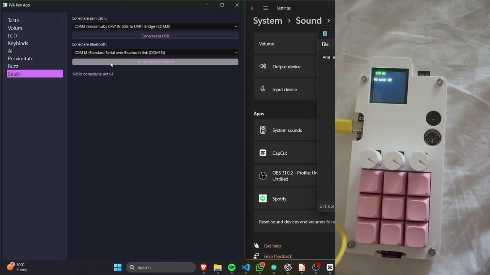

# Hi, I'm Andrei 👋

### Hardware · Embedded Systems · Desktop Software

**I build devices and the software that brings them to life.**

[Featured work](#featured-work) · [Technologies](#technologies) · [Get in touch](mailto:andrei.ivascu5@yahoo.com)

I'm **Ioan-Andrei Ivașcu**. I work across custom electronics, microcontroller firmware, and desktop applications — from designing a PCB in KiCad to connecting a physical device to software on a computer.

My projects explore programmable input devices, music tools, and assistive-device prototypes. I enjoy bringing hardware and software together, then documenting how the system works.

## Featured work

### ⌨️ IVA DECK

**A custom macro keyboard, built from PCB to desktop app.**

Nine mechanical keys, three physical audio controls, an LCD, and sensors connected to a Python / PyQt6 desktop companion. The project combines custom KiCad boards, ESP32 development, configurable macros, Windows audio control, and a Random Forest behavioral-recognition experiment.

**ESP32 · C++ · Python · PyQt6 · KiCad · scikit-learn**

[Explore the project](https://github.com/AndreiasM5/IVA_DECK) · [Watch the demo](https://github.com/AndreiasM5/IVA_DECK/blob/main/docs/media/iva-deck-demo.mp4) · [Read the technical guides](https://github.com/AndreiasM5/IVA_DECK/tree/main/docs)

### More things I've built

| Project | What it does | Built with |
| --- | --- | --- |
| [🎵 Lumentra](https://github.com/AndreiasM5/lumentra-usb-midi) | USB-MIDI controller with four note buttons and touchless expression control for a DAW such as FL Studio | Rust, Pico 2 W, USB-MIDI, KiCad |
| [🎸 Ukulele Tuner](https://github.com/AndreiasM5/esp32-ukulele-tuner) | Microphone-based pitch detection with a color display, servo actuation, and audible feedback | Rust, ESP32, I2S, ESP-IDF |
| [💊 Smart Pill Dispenser](https://github.com/AndreiasM5/esp32-smart-pill-dispenser) | Dual-controller prototype with dispensing, reminders, button confirmation, and camera capture | C++, ESP32 / ESP32-S3, PlatformIO, ESP-NOW |

## Technologies

| Area | Tools I use |
| --- | --- |
| Programming | Python, C / C++, Rust |
| Embedded systems | ESP32, ESP32-S3, Raspberry Pi Pico 2 W, Arduino, ESP-IDF, PlatformIO |
| Hardware design | KiCad, PCB design, sensor and peripheral integration |
| Desktop software | PyQt6, serial communication, hardware control interfaces |
| Data and experiments | pandas, scikit-learn, feature extraction, Random Forest |

## Let's build something

I'm interested in collaborating on embedded devices, custom peripherals, and Python applications that interact with real hardware.

📫 **[andrei.ivascu5@yahoo.com](mailto:andrei.ivascu5@yahoo.com)**
