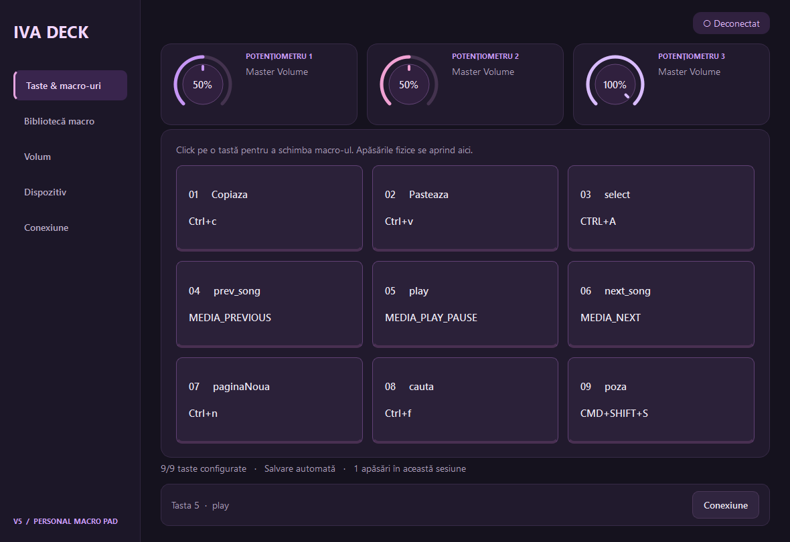

# Hi, I'm Andrei 👋

### Hardware · Software

**I build devices and the software that brings them to life.**

[Featured work](#featured-work) · [Download IVA DECK V5](https://github.com/AndreiasM5/IVA_DECK/releases/latest) · [Technologies](#technologies) · [Get in touch](mailto:andrei.ivascu5@yahoo.com)

I'm **Ioan-Andrei Ivașcu**. I work across custom electronics, microcontroller firmware, and desktop applications — from designing a PCB in KiCad to connecting a physical device to software on a computer.

My projects explore programmable input devices, music tools, and assistive-device prototypes. I enjoy bringing hardware and software together, then documenting how the system works.

## Featured work

### ⌨️ IVA DECK

**A custom macro keyboard, built from PCB to desktop app.**

Nine mechanical keys, three physical audio controls, an LCD, and sensors connected to a Python / PyQt6 desktop companion over Bluetooth or USB serial. I designed the custom KiCad boards and developed the device integration, configurable macros, Windows audio controls, and desktop interface. The original thesis also explored behavioral recognition with Random Forest.

**ESP32 · C++ · Python · PyQt6 · KiCad · scikit-learn**

[Explore the project](https://github.com/AndreiasM5/IVA_DECK) · [Watch the demo](https://github.com/AndreiasM5/IVA_DECK/blob/main/docs/media/iva-deck-demo.mp4) · [Read the technical guides](https://github.com/AndreiasM5/IVA_DECK/tree/main/docs)

#### IVA DECK V5 — Windows app, now available

The latest desktop companion turns the keyboard into an everyday macro pad, with a purple/pink interface and a Windows installer that runs without a separate Python installation.

- **Macros:** assign shortcuts to the nine keys, capture key combinations, and manage them in an editable library.
- **Audio:** watch three animated potentiometers respond to the physical controls and choose an application for each volume channel.
- **Device controls:** monitor proximity, trigger the buzzer, and send text to the LCD.
- **Daily use:** saved macros, audio targets and connection settings, with Bluetooth/USB serial support.
- **Distribution:** Windows installer, portable ZIP, GPLv3 source and SHA-256 checksums. AI and SD-image workflows are outside the V5 release.

**[Download the Windows installer](https://github.com/AndreiasM5/IVA_DECK/releases/download/v5.0.0/IVA-DECK-5.0.0-Setup-x64.exe)** · [V5.0.0 release & portable app](https://github.com/AndreiasM5/IVA_DECK/releases/tag/v5.0.0) · [Installation guide (RO)](https://github.com/AndreiasM5/IVA_DECK/blob/main/docs/windows-app-v5.ro.md) · [Source & build instructions](https://github.com/AndreiasM5/IVA_DECK/tree/main/SOFTWARE/APP/v5)

*Windows 10 21H2+ / Windows 11 x64. The first installer is unsigned; release notes explain the Windows SmartScreen warning.*

### More things I've built

| Project | What it does | Built with |
| --- | --- | --- |
| [🎵 Lumentra](https://github.com/AndreiasM5/lumentra-usb-midi) | USB-MIDI controller with four note buttons and touchless expression control for a DAW such as FL Studio | Rust, Pico 2 W, USB-MIDI, KiCad |
| [🎸 Ukulele Tuner](https://github.com/AndreiasM5/esp32-ukulele-tuner) | Microphone-based pitch detection with a color display, servo actuation, and audible feedback | Rust, ESP32, I2S, ESP-IDF |
| [💊 Smart Pill Dispenser](https://github.com/AndreiasM5/esp32-smart-pill-dispenser) | Dual-controller prototype with dispensing, reminders, button confirmation, and camera capture | C++, ESP32 / ESP32-S3, PlatformIO, ESP-NOW |

## Technologies

| Area | Tools I use |
| --- | --- |
| Programming | Python, C / C++, Rust |
| Embedded systems | ESP32, ESP32-S3, Raspberry Pi Pico 2 W, Arduino, ESP-IDF, PlatformIO |
| Hardware design | KiCad, PCB design, sensor and peripheral integration |
| Desktop software | PyQt6, serial communication, hardware control interfaces, Windows packaging with PyInstaller and Inno Setup |
| Data and experiments | pandas, scikit-learn, feature extraction, Random Forest |

## Let's build something

I'm interested in collaborating on embedded devices, custom peripherals, and Python applications that interact with real hardware.

📫 **[andrei.ivascu5@yahoo.com](mailto:andrei.ivascu5@yahoo.com)**
